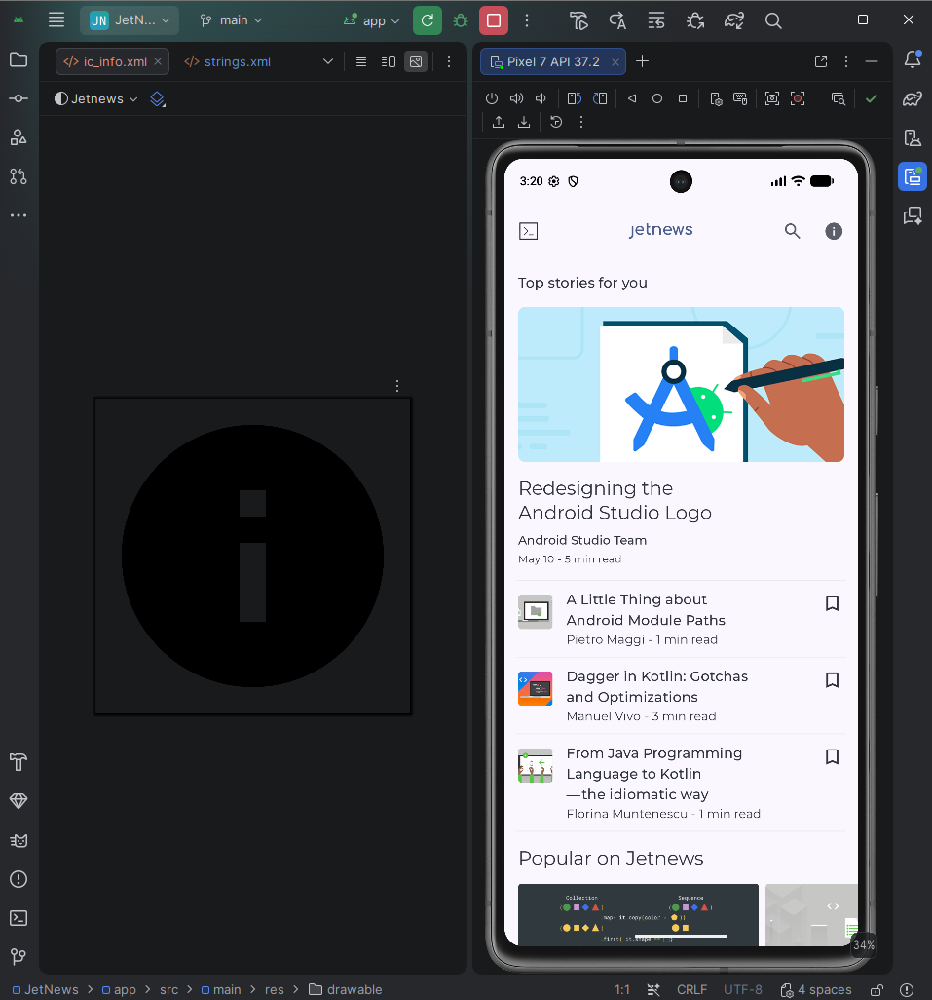
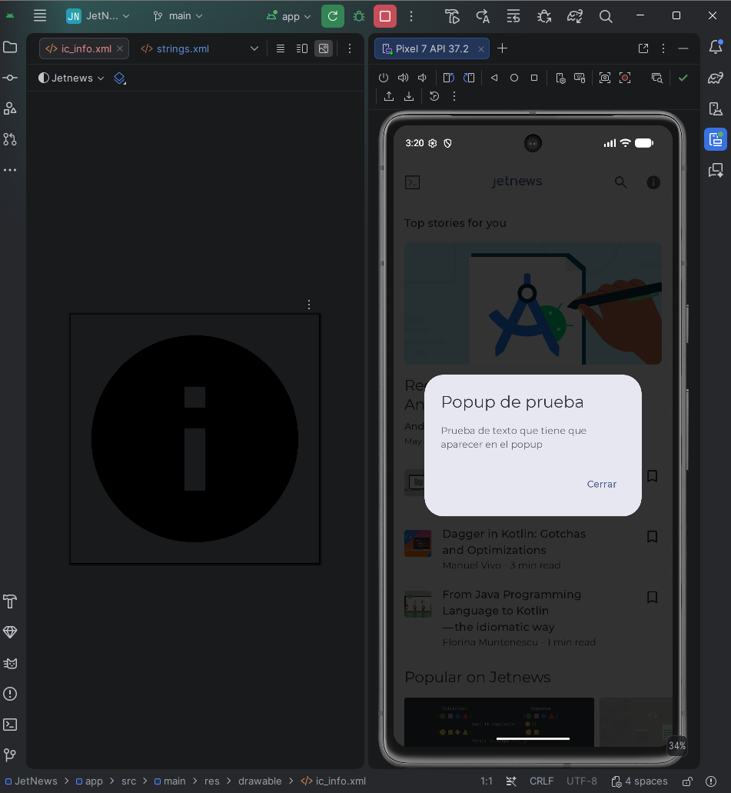

# A2.2 · Modificación funcional de una app existente

## Objetivo: intervenir sobre código ajeno de forma segura, siguiendo el proceso descrito en la página anterior.

## Modificación hecha: 
Añadir un botón en la barra de navegación de la aplicación para que muestre un 
popup sencillo con titulo y texto

## Cambios hechos en el código:

En el archivo HomeScreens.kt, en la función HomeTopAppBar, añadí un nuevo botón y una variable para
guardar el estado del dialogo, añadí el import androidx.compose.runtime.setValue para poder leer y 
modificar el estado de la variable
-------------------------------------------------------------
import androidx.compose.material3.AlertDialog
import androidx.compose.runtime.setValue
import androidx.compose.runtime.mutableStateOf
import androidx.compose.runtime.saveable.rememberSaveable
var showInfoDialog by rememberSaveable { mutableStateOf(false) }
//Nuevo boton para mostrar un popup en pantalla
IconButton(onClick = { showInfoDialog = true }) {
    Icon(
        painter = painterResource(R.drawable.ic_info),
        contentDescription = stringResource(R.string.cd_info),
    )
}
//Fin de nuevo boton

//Popup que salta al pulsar el boton
if (showInfoDialog) {
    AlertDialog(
        onDismissRequest = {showInfoDialog = false },
        title = { Text(stringResource(R.string.info_dialog_title)) },
        text = { Text(stringResource(R.string.info_dialog_text)) },
        confirmButton = {
            TextButton(onClick = { showInfoDialog = false }) {
                Text(stringResource(R.string.info_dialog_close))
            }
        },
    )
}

------------------------------------------------------------
En el archivo res/values/strings.xml añadí unos valores para mostrar texto en el popup:
----------------------------------------------
<!-- NUEVOS VALORES PARA EL BOTON CREADO -->
<string name="cd_info">Información</string>
<string name="info_dialog_title">Popup de prueba</string>
<string name="info_dialog_text">Prueba de texto que tiene que aparecer en el popup </string>
<string name="info_dialog_close">Cerrar</string>
--------------------------------------------------

En la carpeta res/drawable cree un nuevo icono para el boton a implementar llamado ic_info, usando
uno de los iconos que dá a elegir android studio

## Por qué elegí ese punto del código 
Porque es el sitio donde la app ya coloca sus acciones, y el boton de búsqueda está en el mismo bloque
actions
 

Código modificado: [repositorio](https://github.com/AlexAP3611/compose-samples/tree/a2-2-boton-info) · 
[commit con el cambio](https://github.com/AlexAP3611/compose-samples/commit/a95b6fab64ad870b8c1abf7e3384c23ccc45360a)