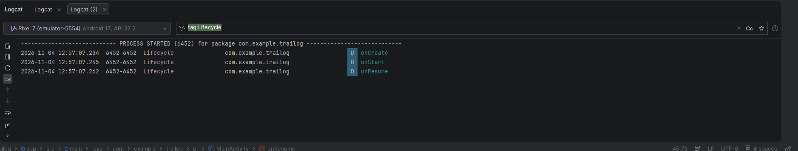
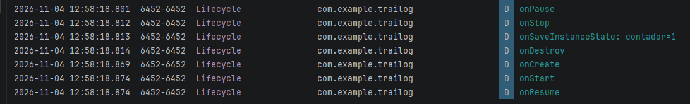
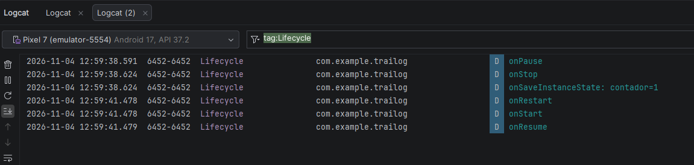
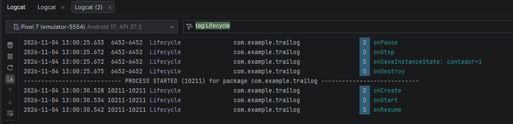

# A2.3 · Experimento de ciclo de vida
## Objetivo: observar de primera mano las transiciones de estado de una Activity.

## Sobre un proyecto propio (puede ser el esqueleto del Proyecto A si ya existe, o un proyecto de prueba), 
## añade trazas de Log.d en todos los callbacks del ciclo de vida (onCreate, onStart, onResume, onPause, onStop, onDestroy).
## Con Logcat abierto, provoca y registra al menos estas situaciones:
## Arranque normal de la app.

La secuencia es onCreate → onStart → onResume, el sistema crea el proceso de la app desde cero.
## Girar la pantalla.

La secuencia es onPause → onStop → onSaveInstanceState: contador=1 → onDestroy → onCreate → onStart → onResume
El sistema pausa la aplicacion, la para, guarda la información que tenia, la destruye y la vuelve a crear
de cero pero en la nueva orientación
## Pulsar el botón de inicio y volver a la app.

La secuencia es onPause → onStop → onSaveInstanceState, y tres segundos después, onRestart → onStart → onResume
No hay onDestroy, la Activity solo pasa a segundo plano y sigue viva en memoria, por eso después de 
guardar la información se ejecuta onRestart
## Cerrar completamente la app y reabrirla.

La secuencia es onPause → onStop → onSaveInstanceState → onDestroy, y luego PROCESS STARTED con onCreate → onStart → onResume
## código de onSaveInstanceState y una comprobación de que funciona.
[commit con los cambios realizados](https://github.com/AlexAP3611/Trailog/commit/7128d38b3ff4c17219c34f12460da74557932cad)