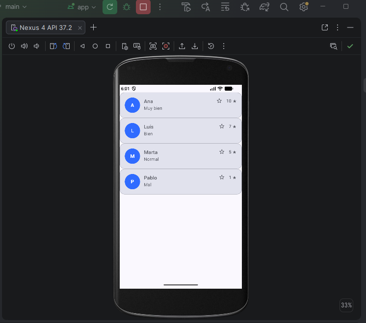

# Tarjeta de reseña

Código: [repositorio del proyecto de prueba](https://github.com/AlexAP3611/practicas-compose) · 
[commit de la actividad](https://github.com/AlexAP3611/practicas-compose/commit/e429e9d2439121dc3af5ec9a72bca735d31ec350)

## Qué composables de estructura has usado y por qué

He usado `Card`, `Row`, `Column` y `Box`. La tarjeta (`Card`) agrupa toda la reseña con esquinas redondeadas y 
borde, como en el mockup. Dentro, un `Row` coloca en horizontal las tres partes: el avatar, el texto y la valoración. 
El texto se organiza con una `Column`, que apila el nombre y el comentario en vertical. El avatar es un `Box` recortado en círculo, 
que centra las iniciales sobre el fondo de color. La valoración es otro `Row` anidado, con el icono de estrella, el número y la estrella final.

A la `Column` del texto le aplico `Modifier.weight(1f)` para que ocupe el espacio libre del `Row` y 
la valoración quede pegada al borde derecho.

## Qué componentes comunes has usado y para qué

- `Text`: nombre, comentario, iniciales y valoración. Uso los estilos del tema (`MaterialTheme.typography`) para distinguir el nombre del comentario.
- `Icon`: las estrellas de la valoración. Elijo `Icon` y no `Image` porque son iconos: admiten `tint` y obligan a decidir el `contentDescription`. 
Lo dejo en `null` porque son decorativas: el número ya comunica la valoración.
- `Card`: el contenedor visual de la reseña.

## Qué diferencia hay entre parámetros y contenido (trailing lambda)

En `Row(modifier = ..., verticalAlignment = ..., horizontalArrangement = ...) { ... }`, lo que va entre 
paréntesis son los **parámetros**, que configuran cómo se comporta el `Row`. Lo que va entre llaves es 
el **contenido**: los composables hijos. Es una lambda que se pasa como último parámetro, y por eso 
Kotlin permite escribirla fuera de los paréntesis (*trailing lambda*). Lo mismo ocurre con `Card`, `Column` y `Box`.

Mi propio composable, `FilaResenya`, también separa las dos cosas: los datos (`nombre`, `comentario`, `valoracion`) 
y el `modifier` entran como parámetros, y su contenido es la estructura que dibuja.

## Cómo se ha reutilizado FilaResenya

`FilaResenya` no contiene ningún texto escrito a fuego: todos los datos llegan por parámetros. 
Por eso la misma función sirve para todas las reseñas. En `ListaResenas` recorro la lista de ejemplo con `forEach` 
y llamo a `FilaResenya` una vez por cada reseña, dentro de una `Column`. Uso `Column` y no `LazyColumn` porque son solo [4] elementos.

## Resultado

