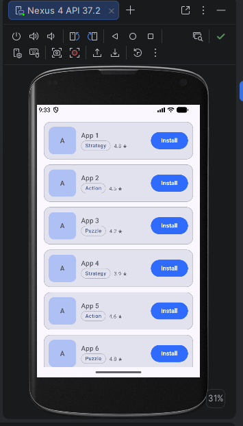

## Por qué LazyColumn y no Column

He usado `LazyColumn` porque el listado tiene 30 elementos y, en una aplicación real, podría tener muchos más.

Una `Column` compone todos sus hijos a la vez, se vean en pantalla o no, y por sí sola no permite 
desplazarse (habría que añadirle `verticalScroll`). Con 30 filas no se nota, pero con cientos o miles 
gastaría memoria y tiempo de más al construir elementos que el usuario nunca llega a ver.

Una `LazyColumn` solo compone los elementos visibles en cada momento, junto con unos pocos cercanos. 
Cuando el usuario se desplaza, deja de mantener los que salen de la pantalla y compone los nuevos. 
Además incluye el desplazamiento vertical de serie. Su contenido no se escribe con `forEach` sino 
con `items(lista) { elemento -> ... }`, que indica qué lista se recorre y cómo se dibuja cada elemento.

La elección depende del volumen de datos: en la actividad anterior usé una `Column` para 4 reseñas 
porque eran pocas y fijas, y aquí uso `LazyColumn` porque el número de apps es mayor y puede crecer.

