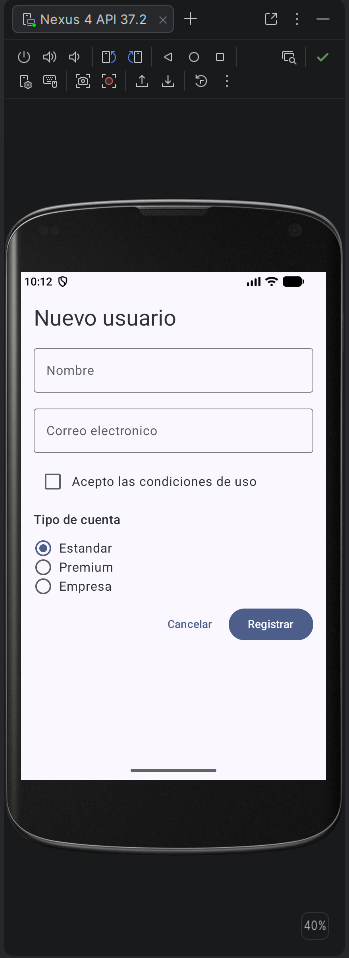

# Formulario de nuevo usuario

## Qué componentes de entrada de datos has usado y para qué

- `OutlinedTextField` (dos): uno para el nombre y otro para el correo electrónico. Cada uno recibe el 
- texto actual (`value`) y una función que se ejecuta cada vez que el usuario escribe (`onValueChange`). 
El del correo usa `KeyboardType.Email` para que el teclado ofrezca la arroba.
- `Checkbox`: para aceptar las condiciones de uso. Va junto a un `Text` dentro de un `Row`, porque 
el checkbox no incluye texto propio.
- `RadioButton` (tres, uno por tipo de cuenta: Estandar, Premium y Empresa): permiten elegir una única opción entre varias.
- `Button` ("Registrar") como acción principal y `TextButton` ("Cancelar") como acción secundaria. 
No hacen nada al pulsarlos, como indica el enunciado.

## Cómo se garantiza que los RadioButton sean excluyentes

Los tres botones no son independientes entre sí: comparten **una única variable**, `tipoSeleccionado`, 
que guarda la opción elegida. Cada `RadioButton` se muestra marcado solo si su tipo coincide con el 
valor de esa variable (`selected = (tipo == tipoSeleccionado)`), y al pulsar una opción se asigna ese 
tipo a la variable. Como la variable solo puede tener un valor a la vez, solo un botón puede estar marcado.

Cada opción es un `Row` completo marcado como `selectable`, dentro de un contenedor con `selectableGroup()`. 
Así se puede pulsar tanto el círculo como el texto, y los lectores de pantalla entienden que forman 
un grupo de opciones excluyentes. Por eso el `RadioButton` lleva `onClick = null`: el clic lo gestiona la fila.

## Cómo está organizada la pantalla

Toda la pantalla es una `Column` con una separación fija de 12 dp entre elementos (`Arrangement.spacedBy`) 
y un margen de 16 dp. Dentro, de arriba abajo: el título, los dos campos de texto, el checkbox con su texto 
(un `Row`), el título "Tipo de cuenta", el grupo de radios (otra `Column`, con un `Row` por opción) y, al final, 
un `Row` alineado a la derecha con los dos botones.

La `Column` principal tiene `verticalScroll`, de modo que el formulario se puede desplazar si la pantalla 
es pequeña o aparece el teclado.

## Sobre el estado

El enunciado indica que el formulario no tiene que hacer nada al enviarse, pero para que los componentes 
sean usables necesitan recordar su valor. Por eso cada uno tiene una variable con `rememberSaveable { mutableStateOf(...) }`. 
Al cambiar su valor, Compose redibuja el componente, y `rememberSaveable` conserva los datos al girar la pantalla. 
El manejo del estado en profundidad se trabajará en la unidad siguiente.

## Resultado

